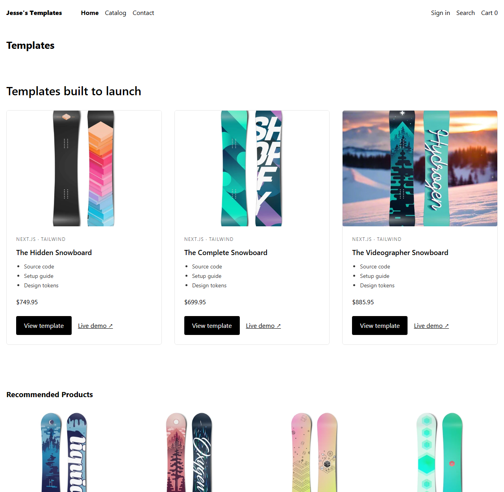
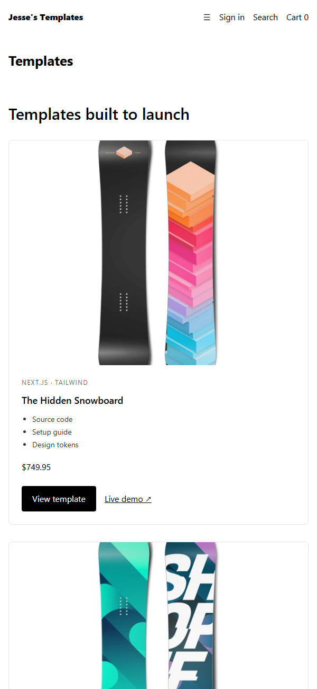

# Jesse's Templates: Hydrogen storefront

A headless Shopify storefront built with **Hydrogen** (React Router, TypeScript, Tailwind v4), connected to a live Shopify store through the **Storefront API** and deployed to **Oxygen**.

It's one half of a "same feature, built two ways" project. The other half is a Liquid theme section.

| | Liquid theme | Hydrogen (this repo) |
|---|---|---|
| Feature | Template showcase cards | Template showcase cards |
| Code | [`sections/template-showcase.liquid`](https://github.com/YinYangPanda10101/jesse-shop-theme/blob/main/sections/template-showcase.liquid) | [`app/components/TemplateShowcase.tsx`](app/components/TemplateShowcase.tsx) |
| Data | Liquid `product.metafields` | Storefront API GraphQL, codegen-typed |
| Configured by | Merchant, in the theme editor (``) | Developer, in code |
| Rendering | Shopify's servers | Server-side React on Oxygen, streamed and deferred |

Both read the same product metafields: `custom.stack`, `custom.demo_url` and `custom.what_s_included` (a list). A third repo, [store-insights](https://github.com/YinYangPanda10101/store-insights), is an admin app that audits those same metafields through the Admin API.





## What was built on top of the skeleton

- **`TemplateShowcase`**: loads the `templates` collection as deferred data, so a slow or failed query can't block or break the homepage. Every metafield is optional and a card still renders without it. List metafields arrive as a JSON string and are parsed defensively.
- **Tailwind v4 and the skeleton's CSS.** The skeleton's `reset.css` and `app.css` were unlayered, and unlayered CSS beats every cascade layer. That silently overrode every Tailwind utility (white button text became black, list bullets disappeared, heading sizes were ignored). Both files now sit in Tailwind's `base` and `components` layers, so the skeleton looks the same and utilities work.
- **Dark-mode browsers.** The skeleton set no page background, so a dark-mode browser painted black text on a dark canvas. It now declares `color-scheme: light` with explicit body colours.

## Running it

The storefront is deployed to Oxygen. Development stores only allow *private* Oxygen environments, so the live URL is limited to store staff. The screenshots above come from the running storefront and real store data.

```bash
npm install
npx shopify hydrogen link   # connect to a store (or run on mock.shop without it)
npm run dev
```

---

# Hydrogen template: Skeleton

Hydrogen is Shopify’s stack for headless commerce. Hydrogen is designed to dovetail with [React Router](https://reactrouter.com/), the modern multi-strategy router for React. This template contains a **minimal setup** of components, queries and tooling to get started with Hydrogen.

[Check out Hydrogen docs](https://shopify.dev/custom-storefronts/hydrogen)
[Get familiar with React Router](https://reactrouter.com/start/framework/routing)

## What's included

- React Router
- Hydrogen
- Oxygen
- Vite
- Shopify CLI
- ESLint
- Prettier
- GraphQL generator
- TypeScript and JavaScript flavors
- Minimal setup of components and routes

## Getting started

**Requirements:**

- Node.js version 22.x or 24.x

```bash
npm create @shopify/hydrogen@latest
```

## Building for production

```bash
npm run build
```

## Local development

```bash
npm run dev
```

## Setup for using Customer Account API (`/account` section)

Follow step 1 and 2 of <https://shopify.dev/docs/custom-storefronts/building-with-the-customer-account-api/hydrogen#step-1-set-up-a-public-domain-for-local-development>
